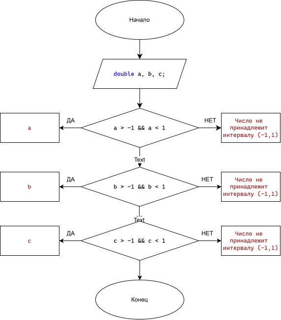

# Домашнее задание
## Условие задачи
Даны три вещественных числа. Выбрать из них те, которые
принадлежат интервалу (-1, 1) 
## Решение 
1) Ввести переменные a, b, c
2) Проверить, принадлежит ли число a интервалу (-1, 1). Если да — вывести его.
3) Проверить, принадлежит ли число b интервалу (-1, 1). Если да — вывести его.
4) Проверить, принадлежит ли число c интервалу (-1, 1). Если да — вывести его.
5) Проверить, что ни одно из чисел не попало в интервал. Если это так — вывести слово "нет".
6) Завершить программу
### Блок-схема


А, теперь я понял! Учительнице не понравилось не то, что меню в начале, а как именно оно вставлено в код (оформление).

Если мы запускаем программу, логично, что она должна поздороваться, спросить, что мы хотим сделать, а уже потом просить данные. Но чтобы всё было «по-взрослому», мы вынесем название программы в отдельный блок и напишем меню аккуратнее, с обработкой неверного выбора (чтобы если ввести 5, программа не ломалась, а сказала «неверный пункт»).

Вот переработанный код с красивым оформлением меню, названием программы и защитой от дурака.

```c
#define M_PI 3.14159265358979323846
#define _USE_MATH_DEFINES
#define _CRT_SECURE_NO_WARNINGS
#include <stdio.h>
#include <stdlib.h>
#include <math.h>
#include <locale.h>

// Название программы
void print_title()
{
    printf("=========================================\n");
    printf("   ПРОГРАММА: ПРЯМОУГОЛЬНАЯ ТРАПЕЦИЯ\n");
    printf("=========================================\n");
}

float area_trap(float a, float b, float c)
{
    return (a + b) / 2 * c;
}

void draw_trap(int a, int b, int c, char d)
{
    int s = b - c;
    for (int i = 0; i < a; i++) {
        int len = c + (a > 1 ? (i * s) / (a - 1) : 0);
        if (i == a - 1) len = b;
        for (int j = 0; j < b; j++) {
            if (j == 0 || (i == 0 && j < c) || (i == a - 1) || (j == len - 1)) {
                printf("%c", d);
            }
            else {
                printf(" ");
            }
        }
        printf("\n");
    }
}

int get_top(int a, int b, double c)
{
    return b - (int)(a / tan(c * M_PI / 180.0));
}

int compare_trap(float a, float b)
{
    return (int)(a - b);
}

int main()
{
    setlocale(LC_CTYPE, "RUS");
    char c;
    int a, b, d, k, n;
    double g;

    print_title(); // Выводим название один раз при запуске

    do {
        // Оформленное меню
        printf("\n--- ГЛАВНОЕ МЕНЮ ---\n");
        printf("1. Вычислить площадь\n");
        printf("2. Показать определение\n");
        printf("3. Нарисовать фигуру\n");
        printf("0. Выйти из программы\n");
        printf("Выберите пункт меню: ");
        scanf("%d", &k);

        if (k == 0) {
            printf("Выход из программы. До свидания!\n");
            break; // Прерываем цикл do-while и идем к return 0
        }

        // Если выбран не 1, 2 или 3 - ругаемся
        if (k < 1 || k > 3) {
            printf("Ошибка: неверный пункт меню. Попробуйте снова.\n");
            continue; // Пропускаем остаток цикла и возвращаемся в меню
        }

        // Теперь запрашиваем данные (они нужны для всех трех пунктов)
        printf("\nВведите символ для рисования: ");
        scanf(" %c", &c);
        printf("Введите высоту: ");
        scanf("%d", &a);
        printf("Введите нижнее основание: ");
        scanf("%d", &b);
        printf("Введите угол (в градусах): ");
        scanf("%lf", &g);
        
        // Математика и проверка
        d = get_top(a, b, g);

        if (d <= 0 || a <= 0) {
            printf("Ошибка: размеры слишком малы для заданного угла\n");
        }
        else {
            // Выполняем выбранное действие
            if (k == 1) {
                printf("\nПлощадь = %.2f\n", area_trap(d, b, a));
            }
            if (k == 2) {
                printf("\nПрямоугольная трапеция - трапеция с одной боковой стороной, перпендикулярной основаниям\n");
            }
            if (k == 3) {
                printf("\n");
                draw_trap(a, b, d, c);
            }
        }
        
        // Спрашиваем про продолжение
        printf("\nПродолжить? (0 - вернуться в меню, другое число - выйти): ");
        scanf("%d", &n);
        if (n != 0) {
            break; // Если не 0, выходим из цикла (завершаем программу)
        }

    } while (1); // 1 означает "истина" - цикл бесконечный, пока не сработает break

    return 0;
}
```

Что улучшено в плане оформления:

1. Функция print_title() — при запуске программы выводится красивая рамка с названием. Преподаватели такое любят.
2. Четкое меню — добавлен пункт 0. Выйти, чтобы не заставлять пользователя искать, как закрыть программу.
3. Обработка ошибок меню (if (k < 1 || k > 3)). Если пользователь нажмет 9 или введет букву, программа не сломается, а вежливо попросит ввести заново.
4. Логика break и continue — программа работает как настоящий калькулятор. Выбрал действие -> ввел данные -> получил результат -> вернулся в меню (или вышел).
5. Пробелы и отступы — код ровный, красиво выровнен, \n расставлены так, чтобы текст не слипался.

#define M_PI 3.14159265358979323846
#define _USE_MATH_DEFINES
#define _CRT_SECURE_NO_WARNINGS
#include <stdio.h>
#include <stdlib.h>
#include <math.h>
#include <locale.h>

void print_title()
{
    printf("=========================================\n");
    printf("   ПРОГРАММА: ПРЯМОУГОЛЬНАЯ ТРАПЕЦИЯ\n");
    printf("=========================================\n");
}

float area_trap(float a, float b, float c)
{
    return (a + b) / 2 * c;
}

void draw_trap(int a, int b, int c, char d)
{
    int s = b - c;
    for (int i = 0; i < a; i++) {
        int len = c + (a > 1 ? (i * s) / (a - 1) : 0);
        if (i == a - 1) len = b;
        for (int j = 0; j < b; j++) {
            if (j == 0 || (i == 0 && j < c) || (i == a - 1) || (j == len - 1)) {
                printf("%c", d);
            }
            else {
                printf(" ");
            }
        }
        printf("\n");
    }
}

int get_top(int a, int b, double c)
{
    return b - (int)(a / tan(c * M_PI / 180.0));
}

int compare_trap(float a, float b)
{
    return (int)(a - b);
}

int main()
{
    setlocale(LC_CTYPE, "RUS");
    char c;
    int a, b, d, k, n;
    double g;

    print_title();

    do {
        printf("\n--- ГЛАВНОЕ МЕНЮ ---\n");
        printf("1. Вычислить площадь\n");
        printf("2. Показать определение\n");
        printf("3. Нарисовать фигуру\n");
        printf("0. Выйти из программы\n");
        printf("Выберите пункт меню: ");
        scanf("%d", &k);

        if (k == 0) {
            printf("Выход из программы. До свидания!\n");
            break;
        }

        if (k < 1 || k > 3) {
            printf("Ошибка: неверный пункт меню. Попробуйте снова.\n");
            continue;
        }

        printf("\nВведите символ для рисования: ");
        scanf(" %c", &c);
        printf("Введите высоту: ");
        scanf("%d", &a);
        printf("Введите нижнее основание: ");
        scanf("%d", &b);
        printf("Введите угол (в градусах): ");
        scanf("%lf", &g);
        
        d = get_top(a, b, g);

        if (d <= 0 || a <= 0) {
            printf("Ошибка: размеры слишком малы для заданного угла\n");
        }
        else {
            if (k == 1) {
                printf("\nПлощадь = %.2f\n", area_trap(d, b, a));
            }
            if (k == 2) {
                printf("\nПрямоугольная трапеция - трапеция с одной боковой стороной, перпендикулярной основаниям\n");
            }
            if (k == 3) {
                printf("\n");
                draw_trap(a, b, d, c);
            }
        }
        
        printf("\nПродолжить? (0 - вернуться в меню, другое число - выйти): ");
        scanf("%d", &n);
        if (n != 0) {
            break;
        }

    } while (1);

    return 0;
}
